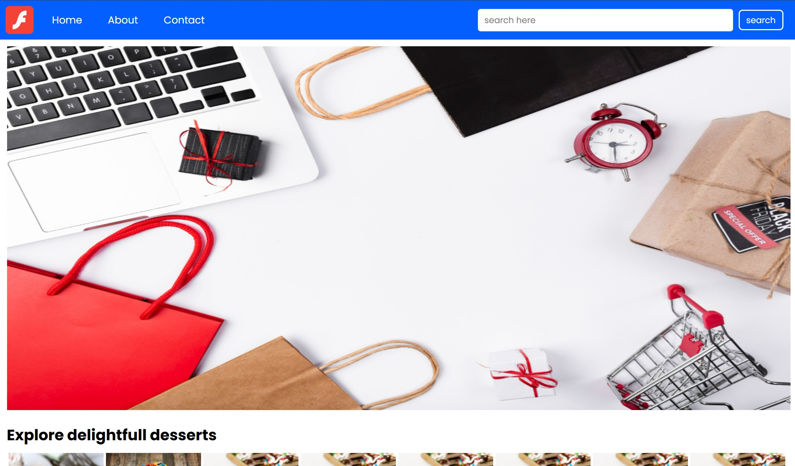

# Mini Ecommerce 🛒

🌟 Welcome to the Mini Ecommerce project! This project is a modern and visually appealing e-commerce website designed to showcase products through an organized layout and a user-friendly interface. It focuses on frontend web development, attractive product displays, and a smooth browsing experience. 🌟

## 🕶 Preview



## 📝 Overview

Mini Ecommerce is a frontend web development project created to demonstrate the design and structure of an online shopping website. It provides an organized platform for displaying products with an attractive layout, intuitive navigation, and visually appealing UI elements.

The project focuses on improving frontend development skills by implementing webpage structure, CSS styling, product layouts, and user interface design.

## 💎 Key Features

- **Attractive Design**: Experience a clean and visually appealing interface designed for online shopping.
- **Product Display**: Browse products presented in an organized and structured layout.
- **Easy Navigation**: Navigate through the website using a simple and user-friendly menu.
- **Product Sections**: Explore different sections for displaying products and categories.
- **Interactive UI Elements**: Enjoy stylish hover effects and visual enhancements.


## 🛠️ Technologies Used

- **HTML5**: Structure the content and layout of the website.
- **CSS3**: Style the interface, product layouts, and visual elements.

## 🚀 Getting Started

To explore the website or contribute to the project, follow these steps:

1. Clone the repository:

   ```bash
   git clone https://github.com/yourusername/mini-ecommerce.git
   ```

2. Open the project directory in your code editor.

3. Launch the `index.html` file in your web browser to view the website.

## 🤝 Contributing

Contributions to enhance the website's design, improve its features, or fix issues are welcome! If you'd like to contribute, please follow these steps:

1. Fork the repository.

2. Create a new branch for your feature or bug fix:

   ```bash
   git checkout -b feature-name
   ```

3. Make your changes and commit them:

   ```bash
   git add .
   git commit -m "Add feature or fix"
   ```

4. Push your changes to your fork:

   ```bash
   git push origin feature-name
   ```

5. Create a pull request on the original repository.

## 📄 License

Check out the license ✒ [License](LICENSE.txt).
